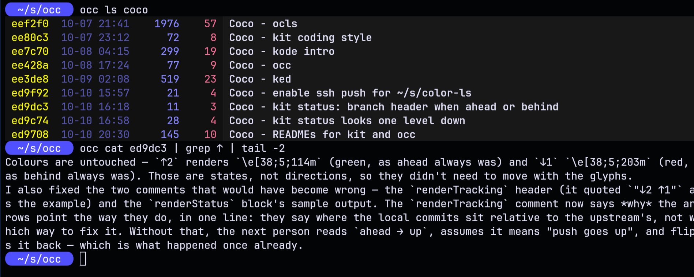

# occ

list, dump and delete opencode v2 sessions

    occ ls [sess...]        print session table
    occ cat [sess...]       show session conversation
    occ log [sess...]       show session history including tool calls
    occ shell [sess...]     show shell commands with their output
    occ del sess [sess...]  delete sessions, asks for confirmation
    occ resume sess         resume a session in opencode
    
    sess: a fragment of a session id or session title
    
    table: id datetime minutes turns title

## Example

## Install

    git clone https://github.com:monsterkodi/occ.git
